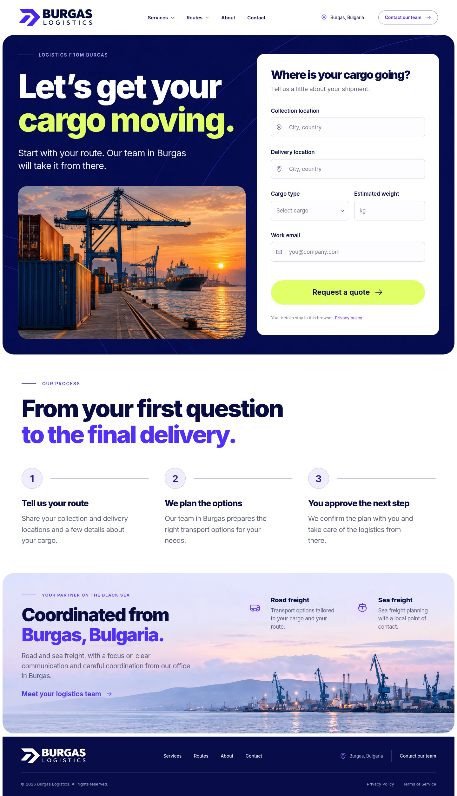

# Burgas Logistics

Адаптивный англоязычный сайт по выбранному варианту №3 с расширенной структурой по Cargov: 12 разделов, полоса партнёров и подвал. Офис в Бургасе, Болгария.

## Посмотреть сайт

1. Скачайте [готовый сайт в ZIP](preview/burgas-logistics.zip).
2. Распакуйте архив.
3. Откройте `index.html` в браузере.

HTML включает изображения, шрифт, стили и JavaScript. Node.js для просмотра не нужен.

[Скриншот компьютера](design/implementation-desktop.jpg) · [Скриншот телефона](design/implementation-mobile.jpg)

[Сравнить три полные версии оформления](design/full-page-variants/README.md) · [Скачать все три версии](preview/design-comparison.zip)



## Что работает

- Адаптивная страница, мобильное меню и меню услуг/маршрутов.
- О компании и показатели, четыре услуги, направления с переключением регионов, шесть типов грузов, этапы работы, преимущества, партнёры, отзывы, статьи, FAQ и блок офиса.
- Выбор направления или типа груза заполняет верхнюю форму; отзывы пролистываются, статьи открываются полностью.
- Информация об услугах и контактах в доступных диалоговых окнах.
- Две независимые формы: проверка полей, просмотр введённых данных и скачивание запроса в TXT.
- Клавиатурная навигация, закрытие меню/диалогов через Escape, состояния фокуса и уменьшение анимации по настройке системы.

Название **Burgas Logistics** временное. Форма не отправляет данные: она позволяет подготовить и скачать запрос. Перед публичным запуском нужны настоящее название компании, подтверждённые услуги, контактные данные, юридические тексты и подключение получателя заявок. Фотографии созданы для концепции и не документируют конкретные объекты компании.

По просьбе заказчика показатели, маршруты, партнёры и отзывы пока выдуманы и помечены на странице как демонстрационные. Данные и тексты этих блоков собраны в [src/content.js](src/content.js) для последующей замены.

## Разработка

Node.js 22.12+; проверено на Node.js 24.19.0 и npm 11.9.0.

```sh
npm ci
npm run dev -- --host 0.0.0.0 --port 4173 --strictPort
```

В облачной среде используйте `npm ci --cache /workspace/.npm-cache --no-fund`, поскольку домашний каталог может быть недоступен для записи. Используйте существующий checkout: каждая облачная задача уже изолирована, создавать worktree не требуется.

## Проверки и сборка

```sh
npm test
```

Команда собирает сайт и выполняет 48 проверок пользовательских сценариев в Chromium с отключённой сетью. Проверяются обе формы, скачивание запроса, меню, диалоги, направления, категории грузов, статьи, FAQ, отзывы и семь ширин от 320 до 1440 px. В облачной среде используется установленный `/usr/bin/chromium`. На другом компьютере сначала выполните `npx playwright install chromium` или укажите путь к браузеру через `CHROMIUM_PATH`.

```sh
npm run build
```

Готовая автономная страница находится в `dist/index.html`. Для Beget и другого статического хостинга достаточно этого файла. Метка `noindex` намеренно оставлена для прототипа; перед запуском её нужно пересмотреть вместе с контентом и контактной формой.

Архив `preview/burgas-logistics.zip` — сохранённая версия для просмотра. После изменения кода его следует обновить из новой сборки. Обычная сборка изменяет только игнорируемую папку `dist/`.

## Источники и проверка дизайна

- [Выбранный макет](design/prototype-3.jpg).
- [Сравнение с реализацией](design/comparison-final.jpg).
- [Отчёт проверки](design-qa.md).
- [Результаты браузерных проверок](qa/verification-results.json).

Иконки: Phosphor (MIT). Шрифт: Inter (SIL OFL). Уведомления об их лицензиях включены в HTML-сборку. Все изображения размещены локально; внешние API и аналитика не используются.
