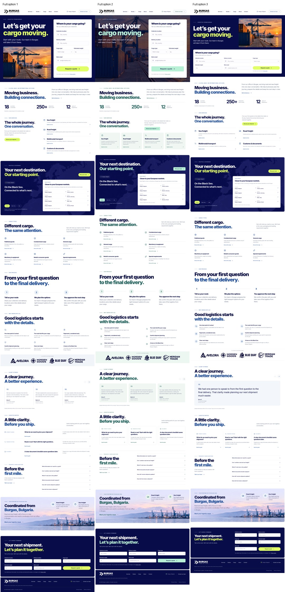

# Три полные версии сайта

По просьбе заказчика сравниваем оформление всей страницы, а не только первого экрана.
В каждой версии 12 основных разделов, полоса партнёров и подвал. Контент и
работающие сценарии одинаковые; меняются композиция, акценты и оформление блоков.

## Открыть в браузере

1. Скачайте [архив с тремя версиями](../../preview/design-comparison.zip).
2. Распакуйте все файлы в одну папку.
3. Откройте `index.html` и выберите вариант. Он откроется в отдельной вкладке.

Интернет и установка программ не нужны. Можно открыть несколько вариантов рядом.
Во всех версиях формы проверяют данные и скачивают запрос, но не отправляют его.

## Полные скриншоты

| Вариант | Компьютер | Телефон |
| --- | --- | --- |
| 1 — синий и лайм, открытые списки | [Вся страница](option-1-desktop.jpg) | [Вся страница](option-1-mobile.jpg) |
| 2 — синий и мятный, фотография и мягкие поверхности | [Вся страница](option-2-desktop.jpg) | [Вся страница](option-2-mobile.jpg) |
| 3 — синий и лайм, широкая форма и крупные отзывы | [Вся страница](option-3-desktop.jpg) | [Вся страница](option-3-mobile.jpg) |

[Общий вид всех трёх](comparison-overview.jpg) ·
[Сравнение услуг](comparison-services.jpg) ·
[Сравнение отзывов](comparison-reviews.jpg) ·
[Сравнение нижней заявки](comparison-enquiry.jpg)



## Основа и воспроизведение

Варианты развивают [последний набор первых экранов](../original-style-variants/)
и ранее выбранный [исходный макет №3](../prototype-3.jpg). Сохраняют его крупную
типографику, тёмно-синюю основу, фотографии порта и заявки. Это варианты для
сравнения, а не утверждённый финальный дизайн. Главный исходный сайт не переключён
на один из них. Точные фотографии из новых сгенерированных макетов не переносились:
используются уже подготовленные локальные изображения проекта.

```sh
npm run build
node design/full-page-variants/build.mjs
PREVIEW_HTML=preview/full-page-variants/option-1.html QA_ARTIFACTS=qa/screenshots/full-option-1 node qa/smoke.cjs
```

Повторите последнюю команду для номеров 2 и 3. HTML-файлы создаются в игнорируемой
папке `preview/full-page-variants/`. Общие и индивидуальные стили находятся рядом
с этим README; данные сайта не дублируются в исходниках вариантов.

Проверки: [144 пройденных сценария](verification-results.json), семь ширин экрана,
офлайн-работа и отсутствие внешних запросов. [Проверка дизайна](design-qa.md).
Показатели, маршруты, партнёры и отзывы пока демонстрационные, как согласовано.
