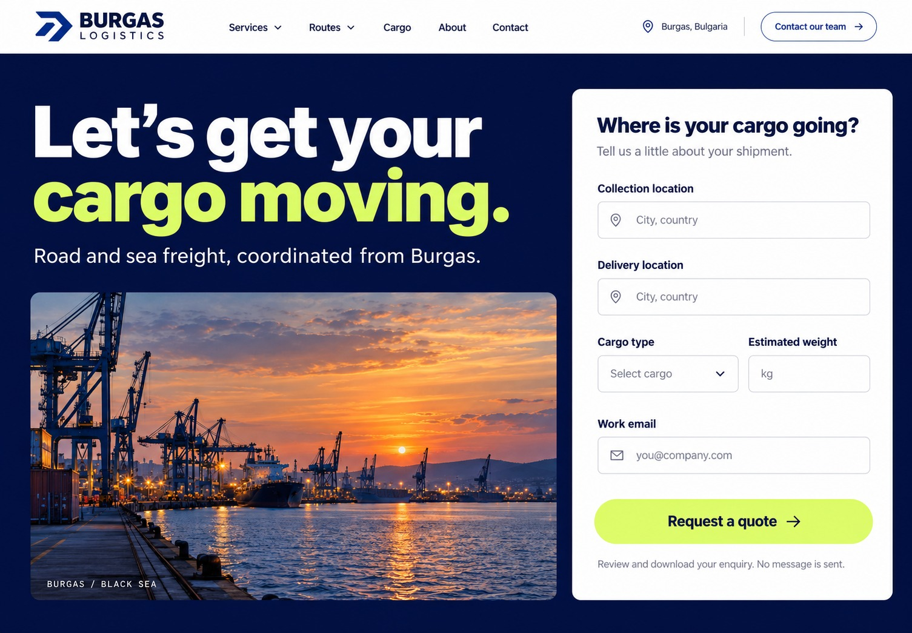
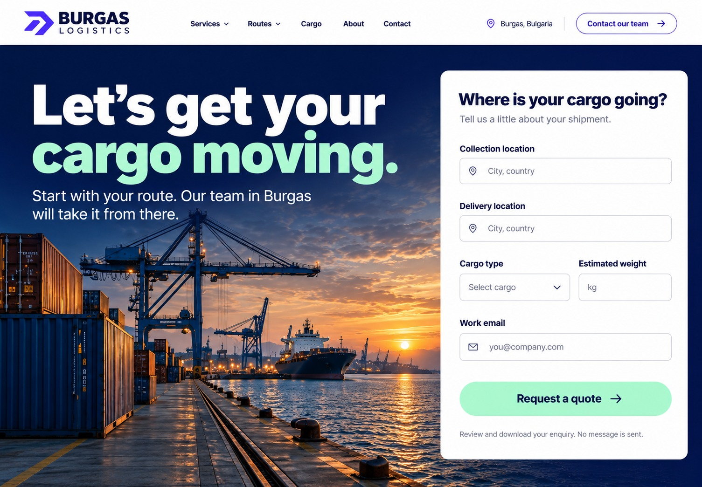
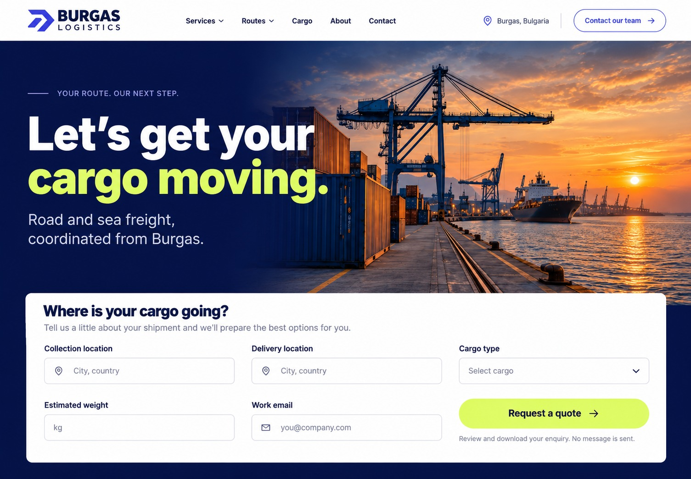

# Развитие первоначального стиля

Три новых макета от 15 октября 2026 года. Номера соответствуют порядку изображений в последнем наборе, показанном в чате.

Это три варианта первого экрана для выбора оформления, а не сокращённые версии сайта. Полная структура — 12 разделов, полоса партнёров и подвал — сохраняется. Работающий сайт пока не изменён.

Основа: ранее выбранный [вариант №3](../prototype-3.jpg), тёмно-синий фон, крупная типографика, портовые фотографии и форма заявки. По новой просьбе заказчика радикальные направления из папки redesign-directions отложены.

- [Вариант 1](option-1.jpg): форма справа, отдельная фотография, исходный лайм, более прямые внешние границы и синие акценты вместо фиолетового.
- [Вариант 2](option-2.jpg): форма справа, крупная фоновая фотография и мятный акцент.
- [Вариант 3](option-3.jpg): исходные синий и лайм, панорамная фотография и широкая форма под заголовком.

Это сгенерированные визуальные ориентиры. Точные тексты, контрастность, поля и адаптивность будут уточнены при реализации выбранного макета. Сгенерированные портовые изображения не документируют конкретные объекты компании.

