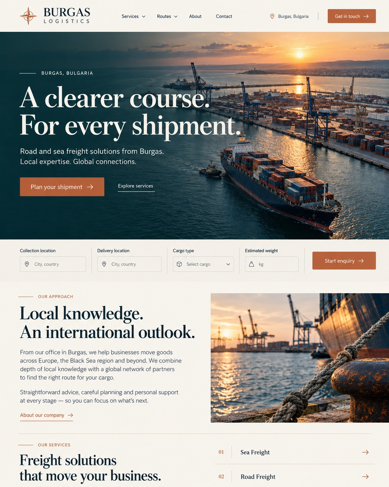
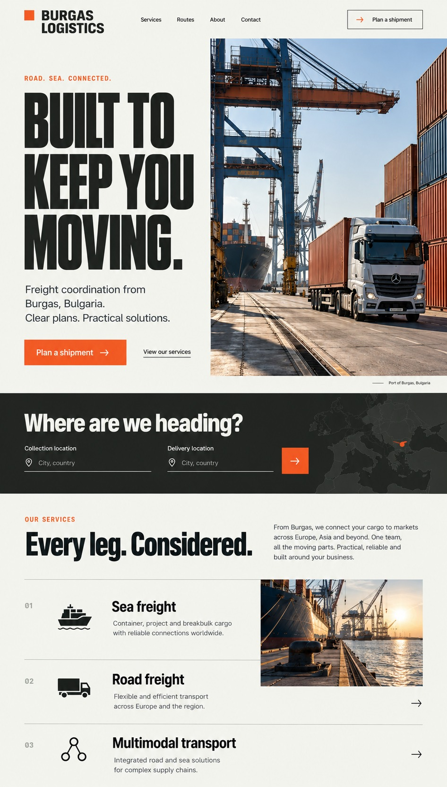
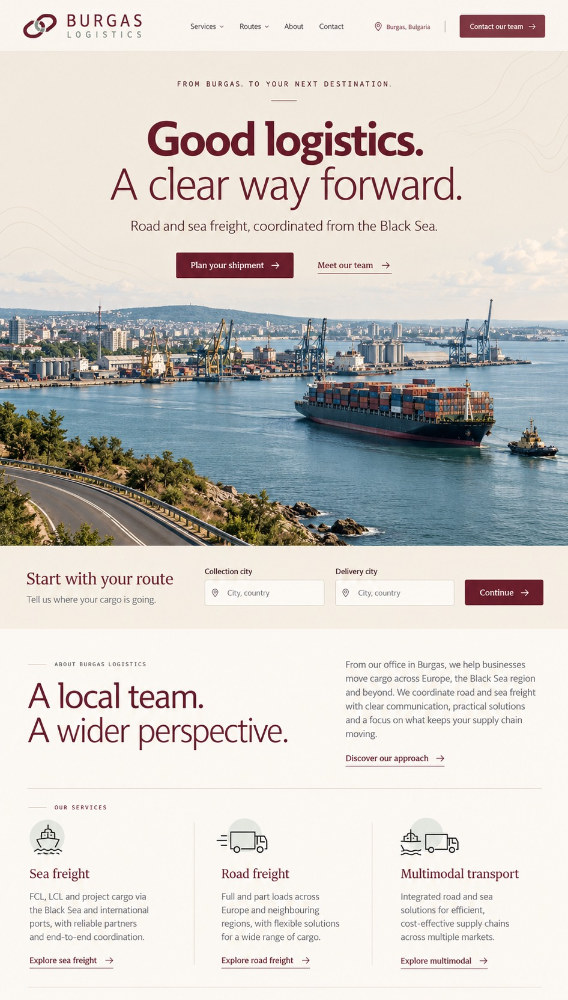

# Новые визуальные направления

Три независимых концепции от 15 октября 2026 года. Нумерация соответствует порядку показа изображений в чате. Это макеты для выбора; работающий сайт пока сохранён в предыдущем оформлении.

- [Вариант 1](option-1.jpg) — Black Sea Atelier: бирюзовый, слоновая кость и медь; крупная фотография и редакционная типографика.
- [Вариант 2](option-2.jpg) — Freight Works: графит, светлый фон и оранжевый; индустриальная композиция и узкий крупный шрифт.
- [Вариант 3](option-3.jpg) — Continental Connections: песочный, бордовый и шалфейный; центрированный первый экран и широкая панорама.

Цель — самостоятельный визуальный образ англоязычной логистической компании из Бургаса. Полная структура из 12 разделов остаётся основой будущей реализации; на макетах показаны первые разделы. Изображения созданы для концепции и не подтверждают реальные объекты или услуги компании.

